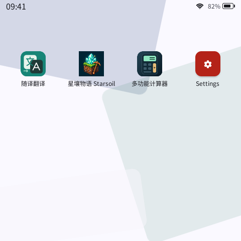
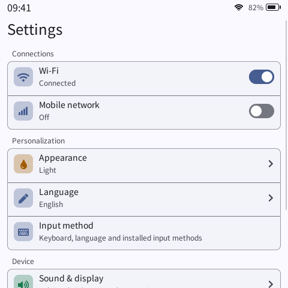

# PXA System

[简体中文](README.md) · [Documentation](docs/README.md) · [Download DevKit](https://pxa.doit.am/docs/downloads/)

<picture><source media="(prefers-color-scheme: dark)" srcset="branding/dist/pxa-horizontal-dark.svg"></picture>

PXA (Portable eXecutable Application) is a portable application system for embedded devices. Apps ship as signed `.pxa` packages and can be installed or updated independently. The system provides shared application lifecycle, UI, permission and service interfaces.

- **Application environment**: native apps and sandboxed PXA apps share identity, lifecycle and system service contracts.
- **Standard system UI**: desktop, settings, themes, localization and display profiles for different screens and input methods.
- **C++ development tools**: a C++26 Guest SDK, app templates, WASI/AOT toolchains, signed packaging and a desktop simulator.
- **Product integration**: a core separated from specific boards, drivers and renderers, with an optional LVGL backend.

## Preview

| Application desktop | System settings |
| :---: | :---: |
|  |  |

Captured from the real standard UI simulator. The apps shown come from [pxa-apps](https://github.com/SmartArduino/pxa-apps) and are installed separately from the system.

## Create your first app

Choose a DevKit for your host from the [downloads page](https://pxa.doit.am/docs/downloads/) and follow the [setup guide](https://pxa.doit.am/docs/setup/) to add its `bin` directory to `PATH`. Then run:

```sh
pxa --version
pxa init hello
pxa run hello
```

DevKit includes the SDK, compilers, packaging tools and a prebuilt simulator. CMake describes project sources and dependencies; `pxa.lock` pins the SDK and toolchain inputs.

Close the simulator, then build a package and check it for publishing:

```sh
pxa build hello --target esp32s3,esp32s31,simulator
pxa publish hello/dist/pxa-hello.pxa --check-only
```

Device firmware must support the app's declared architecture, services and capabilities. See [Your first app](https://pxa.doit.am/docs/first-app/), the [C++ SDK guide (Chinese)](sdk/guest-cpp/README.zh-CN.md) and [DevKit and project locking (Chinese)](docs/zh-CN/devkit.md).

### Work with a coding assistant

[PXA Agent Kit](ai/README.en.md) provides environment setup, app development, simulator verification and device debugging. Give your assistant this request:

> Read https://pxa.doit.am/ai.md, set up the PXA development environment in the current directory, run the simulator to check the environment, then wait for my app requirements.

## Build the system from source

System maintainers can build the Host runtime, simulators and tests independently:

```sh
git clone --recurse-submodules https://github.com/SmartArduino/pxa-system.git
cd pxa-system
cmake -S . -B build
cmake --build build --parallel
ctest --test-dir build --output-on-failure
```

Install a C/C++ compiler, CMake, and development packages for OpenSSL, LZ4, SDL2 and libpng. See the [desktop simulator guide](simulator/desktop/README.md) for dependencies and offline configuration.

ESP firmware and board drivers live in [pxa-workspace](https://github.com/SmartArduino/pxa-workspace). For your own product, see [Product integration](docs/product-integration.md) and [Display profiles and system UI](docs/display-and-system-ui.md).

## Source map

| Directory | Contents |
| --- | --- |
| `libpxa/` | Portable Host runtime and platform adapters |
| `system/` | System core, app runtimes and standard composition |
| `ui/` | System UI, renderers and LVGL backend |
| `services/` | System services and product extension interfaces |
| `sdk/guest-cpp/`, `sdk/templates/` | C++ SDK and app templates |
| `tools/pxa_tools/`, `tools/package/` | DevKit CLI, packaging and signing |
| `ai/` | Agent Kit and coding assistant integration |
| `simulator/` | Headless, desktop and browser simulators |
| `spec/`, `config/` | Protocol specifications and runtime version constraints |

## Documentation and feedback

- [Architecture and interface documentation](docs/README.md)
- [Application and protocol model](docs/app-protocol.md) · [Portability and extensions](docs/portability.md)
- [Releases and release notes](https://github.com/SmartArduino/pxa-system/releases)
- [Bug reports, feature requests and questions](https://github.com/SmartArduino/pxa-system/issues/new/choose), with separate English and Chinese forms

This repository uses the [MIT license](LICENSE). Third-party components retain their own notices. Dependency changes follow the [system license policy](docs/zh-CN/system-license-policy.md).
