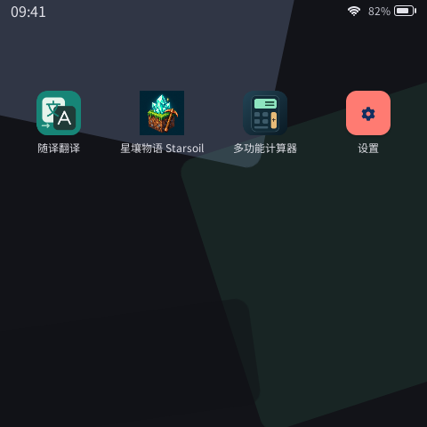
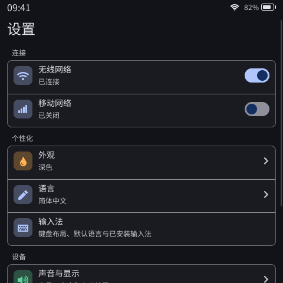

# PXA System

[English](README.en.md) · [开发文档](docs/README.zh-CN.md) · [下载 DevKit](https://pxa.doit.am/docs/downloads/)

<picture><source media="(prefers-color-scheme: dark)" srcset="branding/dist/pxa-horizontal-dark.svg"></picture>

PXA（Portable eXecutable Application）是面向嵌入式设备的可移植应用系统。应用以签名 `.pxa` 包交付，在设备上独立安装和更新；系统提供统一的应用生命周期、界面、权限与服务接口。

- **应用运行环境**：原生应用与沙箱 PXA 应用共用身份、生命周期和系统服务契约。
- **标准系统界面**：桌面、设置、主题、本地化与显示配置，适配不同屏幕和输入方式。
- **C++ 开发工具**：C++26 Guest SDK、应用模板、WASI/AOT 工具链、签名打包与桌面模拟器。
- **产品集成接口**：核心与具体板型、驱动及渲染器分离；LVGL 后端可按产品需要选用。

## 界面预览

| 应用桌面 | 系统设置 |
| :---: | :---: |
|  |  |

真实标准 UI 模拟器画面。图中的应用来自 [pxa-apps](https://github.com/SmartArduino/pxa-apps)，独立于系统安装。

## 创建第一个应用

从[下载页](https://pxa.doit.am/docs/downloads/)选择适合主机的 DevKit，按[安装说明](https://pxa.doit.am/docs/setup/)将其 `bin` 加入 `PATH`，然后运行：

```sh
pxa --version
pxa init hello
pxa run hello
```

DevKit 包含 SDK、编译工具、打包工具和预编译模拟器。项目通过 CMake 描述源码与依赖，通过 `pxa.lock` 固定 SDK 和工具链输入。

关闭模拟器后，可构建应用包并检查发布条件：

```sh
pxa build hello --target esp32s3,esp32s31,simulator
pxa publish hello/dist/pxa-hello.pxa --check-only
```

实际部署时，设备固件须满足应用声明的架构、服务与能力要求。完整流程见 [第一个应用](https://pxa.doit.am/docs/first-app/) · [C++ SDK](sdk/guest-cpp/README.zh-CN.md) · [DevKit 与版本锁定](docs/zh-CN/devkit.md)。

### 使用编程助手

[PXA Agent Kit](ai/README.md) 提供环境准备、应用开发、模拟器验证与设备调试入口。可将下面这句话交给编程助手：

> 请读取 https://pxa.doit.am/ai.md，在当前目录为我配置 PXA 开发环境，运行模拟器检查环境，然后等待我的应用需求。

## 从源码构建系统

系统维护者可以独立构建 Host 运行库、模拟器与测试：

```sh
git clone --recurse-submodules https://github.com/SmartArduino/pxa-system.git
cd pxa-system
cmake -S . -B build
cmake --build build --parallel
ctest --test-dir build --output-on-failure
```

主机需安装 C/C++ 编译器、CMake，以及 OpenSSL、LZ4、SDL2、libpng 开发包。桌面模拟器的依赖和离线配置见 [构建说明](simulator/desktop/README.md)。

ESP 固件与板级驱动在 [pxa-workspace](https://github.com/SmartArduino/pxa-workspace) 维护。接入自己的产品见 [产品集成](docs/zh-CN/product-integration.md) 和 [显示与系统 UI](docs/zh-CN/display-and-system-ui.md)。

## 源码导航

| 目录 | 内容 |
| --- | --- |
| `libpxa/` | 可移植 Host 运行库与平台适配 |
| `system/` | 系统核心、应用运行时与标准组合 |
| `ui/` | 系统界面、渲染器与 LVGL 后端 |
| `services/` | 系统服务与产品扩展接口 |
| `sdk/guest-cpp/`、`sdk/templates/` | C++ SDK 与应用模板 |
| `tools/pxa_tools/`、`tools/package/` | DevKit 命令行、打包与签名 |
| `ai/` | Agent Kit 与编程助手接入 |
| `simulator/` | 无界面、桌面与浏览器模拟器 |
| `spec/`、`config/` | 协议规格与运行时版本约束 |

## 文档与反馈

- [架构与接口文档](docs/README.zh-CN.md)
- [应用与协议模型](docs/zh-CN/app-protocol.md) · [可移植性与扩展](docs/zh-CN/portability.md)
- [发行版与发布说明](https://github.com/SmartArduino/pxa-system/releases)
- [缺陷反馈、功能建议与使用咨询](https://github.com/SmartArduino/pxa-system/issues/new/choose)，提供独立中文、英文表单

本仓库采用 [MIT 许可证](LICENSE)；第三方组件保留各自的许可声明。依赖变更遵循[系统许可证策略](docs/zh-CN/system-license-policy.md)。
