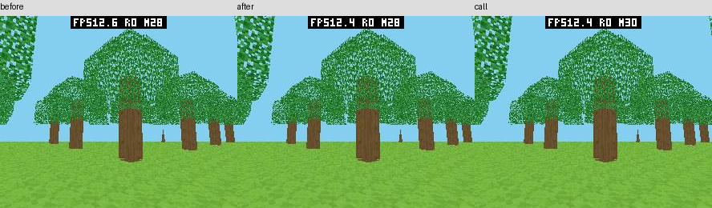
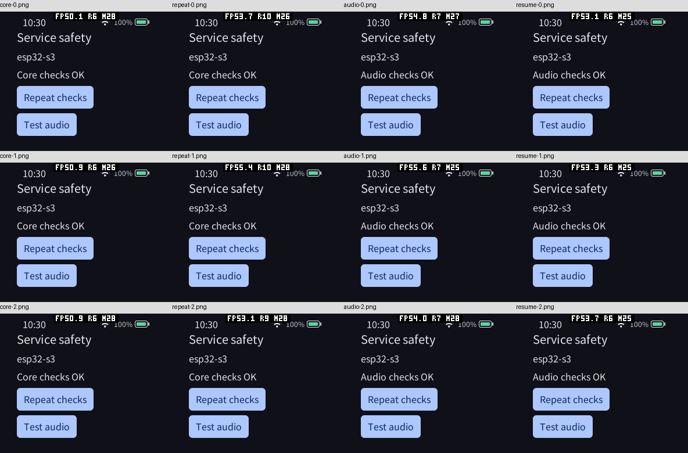

# PXA ABI 审计与重构（2026-10-11）

## 本轮目标

全面审查 Core 导入/导出、命令信封、各服务及数据路径，允许破坏性更新。清理无用、重复或易误用的协议，减少冗余编码、复制和查询；解除与真实资源预算无关的固定容量限制。新通用能力按需启用，保持稳定内存与本次运行峰值不增长。

补充目标：评估新增专用导入及批量调用是否能改善游戏实际显示 FPS 和输入到显示延迟。分别测量 Guest 更新/编码/提交、Host 校验/复制/排队、光栅化和显示。仅在正确性、等效工作负载与内存测量支持收益时采用；不把调用次数减少或提交 FPS 当作最终收益。

审计前，PXA 自定义 Guest→Host 导入为 `pxa_submit` 和 `pxa_io`；本轮新增可选的 `pxa_call`。WASI 为独立导入。Host→Guest 使用 start/event/stop 导出。批量 DrawList 已走 typed Handle I/O，控制接口数不等于边界调用数。

## 审计基线

SDK 起点 `8693fc9`，产品起点 `4faf6cf`。原 SDK/Host 工作区无源代码改动；保留正在另一个任务中修改的 novel-reader 与临时截图。独立基线检出和验证日志在 `local/abi-audit-20261011/`。

已定位：Host 内部 12 字节/32 位请求与 Guest 20 字节/64 位请求不一致；WAMR 每组件固定 16 槽映射；适配器复制服务白名单和载荷限值；每次通知搬移载荷；两套信封生成源；SDK 的 16 请求编译上限；Release 原生测试仅部分目标保留 assert。

## 设计与修改

| 原因 | 实现与收益 | 内存与边界 | 验证 |
| --- | --- | --- | --- |
| Host 12 字节/u32 与 Guest 20 字节/u64 之间反复转换 | 统一 canonical 20 字节信封与 u64 token，删除第二套 schema、codec、WAMR token map 及服务白名单 | Host 默认请求/事件槽大小不变；每组件适配器结构减少 264 B | golden、所有服务原生测试、WAMR/AOT、旧包真机 |
| 小控制请求仍编码、复制、解码信封 | Core 1.1 可选 `pxa_call(route, token, payload, length)`；直接同步借用载荷 | C++ Transport 在 Wasm32 从 536 B 降为 16 B；无默认新缓存 | C++ 直接调用指针/边界/阶段测试，真实 AOT 与真机微基准 |
| 适配器固定 16 请求限制独立于 Runtime 预算 | 移除适配器映射；Host 按 Runtime 配置，SDK 显式容量可到 UINT16_MAX | 默认仍为 16；扩大预算才增加存储，不默认动态扩容 | 32 个低位相同的高 64 位 token、耗尽与复用测试 |
| 未消费的完成事件过早释放 token | token 保留到 mailbox pop/consume；事件槽 union 直接关联请求 | 请求 56 B、事件 32 B 不变；避免交付时报文解析/哈希查找 | 重复 token、取消、伪造通知/完成头、失败 pop、陈旧 consume、停止清理 |
| 通配响应可能误收同 token 通知 | SDK 区分 Core 完成与通知的路由空间 | 原容量不变 | 同 token 的通配 Core 回调和通知回调分别交付 |
| 常见小完成事件经过多次 writer 调用 | 固定信封和状态合并写入；单事件块直接写，较大载荷仍走分块 writer | 无额外缓存或分配；保留截断和取消检查 | 原生请求往返、跨块完成、ASan/UBSan |
| Core 取消和关闭在入口验证后重复查找组件 | 复用入口已验证的组件索引，直接调用同一请求/资源表逻辑；保留 generation、回调阶段、所有权与 token 检查 | 无额外状态或缓存 | 原生及 sanitizer 32 项、模拟器 88 项、WAMR 与 S3 微基准 |
| 扩宽 token 后产生不必要的结构填充 | 重排网络、权限、事件元数据；IPC 内部只存已知 Core 状态，编译期检查其范围；权限提示用非零 prompt ID 表示活动 | 网络 pending 和 IPC 槽保持原尺寸；消除额外活动标记与对齐浪费；不缩窄 wire 字段 | S3 ELF/DWARF 实际尺寸、完整原生及真机权限/服务流程 |
| 版本或错误含义在适配器和服务间漂移 | 服务自己校验 opcode/载荷；非法参数与不支持明确区分；Call 的最低 minor 同时由打包和激活验证 | 既有 Core 1.0 包保留；Host 原生 libpxa 源接口有破坏性变更 | 不合法导入、非函数导入、Core 1.0 导入 Call 拒绝、旧 smoke/IPC/pressure |
| ESP 专用时钟通知手写旧信封缓冲 | 改用 `pxa_event_post_message`，移除临时封包及硬编码大小 | 时钟路径栈空间减少 | 真机发现并修复；固定场景必须收到 tick 并产生 LCD 完成帧 |
| Release 下 assert 中操作消失，测试失真 | 统一只给测试目标保留 assert | 生产构建选项不变 | Release 完整模拟器回归 |
| 显示驱动和测试入口同时清空延迟计数 | 显式 PERF 窗口期间，显示遥测让出计数所有权；结束后恢复正常分窗 | 复用已有可选探针；无新增常驻计数、缓存或设备设置 | 原生测试覆盖竞争消费者；旧版及新版均使用同一测量补丁 |

`pxa_submit` 与 `pxa_io` 的数量本身不是性能瓶颈：一次 DrawList 已包含很多图元。
`pxa_io` 保留用于有类型的资源读写和批量绘制；不增加每图元导入。新增 Call
用于控制路径，不替代绘制队列、权限或异步完成。大资源数据继续走 Handle I/O，
4076 B 的控制载荷上限保留，避免将无界大对象塞进可靠事件池。

服务控制回调只在返回前借用输入。网络、IPC、系统桥等异步后端必须在接受前
复制需要保留的字段；固定配置及资源所有权不因新增导入改变。WAMR 先验证完整
Guest 范围，同步导入期间 Guest 无法并发修改或扩展自己的线性内存。

Core 1.1 是增量 Guest ABI：原来的两导入包可继续使用。破坏性更新发生在 Host
原生接口（`request_id:u32` 改为 `request_token:u64`，删除 `wire_v1.h`）及规范源。
IPC call ID、UI 节点/事务/通知 request ID 和 Work ID 是各自独立的对象编号，
保留原位宽；没有把所有名为 ID 的字段机械扩大。Store 下载进度则携带完整 u64
请求 token，规范和 Host 的 24 字节载荷已对齐。

Host 内部旧的 32 位资源 helper 仍被原生服务及测试使用，不是可加载的旧 Wasm
ABI；本轮没有为删代码而移除有效的原生能力。Payload codec 仍有手写服务实现，
由 golden、边界测试和按服务验证约束，尚未做到全量服务代码生成。

## 测量方法

基线产品 `4faf6cf`、SDK `8693fc9` 使用独立检出；同一 pai-touch ESP32-S3，
序列号 a4:cb:8f:d6:8d:a4，本次端口为 `/dev/ttyACM1`（`/dev/ttyACM2` 不存在）。
只更新应用固件分区；保留原有五个应用、设置和数据。基线也加入只读 `PERF INPUT`
诊断入口，测量窗口之外读取已有计数，不开启显示日志或改变 NVS 设置。

控制请求：相同有效未知请求取消，每批 1000 次、每窗口 32 批，三次冷启动和
三次前后台恢复；WASI 单调时钟包围计时区间，日志在区间之外。对照旧 Host 的
Submit、新 Host 的 Submit、新 Host 的 Call；包摘要随结果保存。此微基准不能
当作游戏 FPS 或端到端输入延迟。

体素：使用同一个 Core 1.0 AOT 测试包先后在两版 Host 运行，再单独测量 Core 1.1
SDK 变体。S2 场景固定种子 0x5ae1、64×24×64 地图/hash 667de4b0、49 棵树，
296×240、视距 24、FOV 1.221451928、near 0.25、眼睛 (18.5,9.6,18.5)、yaw 0.7、
pitch -0.15。保持透视纹理、树叶 cutout、Z-buffer、无 HUD；固定场景不运行物理更新。
每次预热 24 秒且至少 120 帧，再记录 8 秒、重复三次，使用新 FrameId 的 LCD
传输完成间隔推导显示 FPS，检查零溢出、场景 draw bytes/covered pixels 一致。
Guest profile 分别记录几何、编码、HUD、提交和更新；Host 光栅化单独采样，
排队与显示流水线时间从 telemetry 读取，阶段可能重叠，不能相加当帧间隔。

输入：同一场景右侧交替拖动，三次独立启动，分别记录采样→Guest、提交与 LCD
完成，原始截图去掉顶部 24 行 FPS 浮层后验证视角变化。使用显式 PERF 窗口，
防止显示驱动定期清空同一组计数。此前未独占计数的延迟数据全部排除，不能将
窗口尾部的少量样本解释为完整窗口的延迟分布。p95 来自已有直方图，低区间按
1 ms、高区间按 2 ms 分桶，末桶返回实测最大值。这测量时间戳后的合成输入，不包含真实触摸扫描前
延迟；只统计被关联到实际提交/显示帧的样本，不把注入次数当有效样本数。

内存：ESP-IDF 局部最低空闲值分别在启动及稳定窗口前重置，包含快照之间已释放
的分配。首次初始化单独记录；Surface/资源/WAMR 的历史 peak 仅作附加诊断。
Guest linear 包含堆/栈/静态对象；AOT 映射和 WAMR 分配器可能与 PSRAM 总占用重叠，
不重复求和。记录帧、深度/光栅 scratch、命令邮箱及测量探针本身。

## 实测结论

本轮完成统一 ABI、清理适配层及可选 Call，控制调用和 SDK 对象存储有明确收益；
**没有证实游戏显示 FPS 或输入到 LCD 延迟提升**，因此未将生产游戏默认迁移到 Call。
接口数量不决定帧率：当前游戏通过一次 Handle I/O 提交整个 DrawList，主要耗时仍在
Guest 几何处理、同步提交中的 Host 渲染，以及显示流水线。

下表是三轮结果的中位数；控制项先求每轮 32 批中位数。所有完整报告见
[证据目录](abi-audit-20261011/)，包/固件 SHA-256 和基线提交见
[artifacts.json](abi-audit-20261011/artifacts.json)。

| 指标 | 旧 Host / Submit | 新 Host / Submit | 新 Host / Call |
| --- | ---: | ---: | ---: |
| 控制调用冷启动，µs | 12.367 | 13.023 | 10.488 |
| 控制调用恢复，µs | 12.345 | 12.986 | 10.498 |
| 实际显示 FPS | 12.601 | 12.525 | 12.494 |
| LCD 完成间隔，ms | 79.357 | 79.840 | 80.041 |
| Host 光栅化均值，ms | 36.685 | 36.727 | 36.623 |
| Transport，Wasm32 B | 536 | 536 | 16 |

Call 比新 Submit 的冷启动调用中位耗时少 19.5%，比旧 Submit 少 15.2%。新 Submit
在该取消微基准中比旧版多约 0.66 µs：旧适配器对于不存在的 token 在本地表提前返回，
新版进入 Runtime 的完整导入门禁与唯一请求表。它们具有相同调用结果，但执行工作
不同，不能把该比值推广到所有服务。新增入口也不是“零成本 syscall”。

三轮实际显示 FPS 分别为：

- 旧 Submit：12.601 / 12.515 / 12.688。
- 新 Submit：12.525 / 12.471 / 12.546。
- 新 Call：12.398 / 12.494 / 12.508。

新 Submit / Call 中位 FPS 相对基线分别低约 0.6% / 0.9%，三轮小样本不足以证明
细小差异的稳定因果。无论如何不能声称游戏加速。Call 没有改变 DrawList、纹理、
Z-buffer 或光栅内核，游戏控制调用次数也很少；Call 变体 AOT 布局不同，几何阶段
计时增加，不能把所有变化解释为 ABI 边界成本。

### 游戏各阶段

以下取每轮末次有效 profile 后再求三轮中位数；Host 光栅化采用完整 8 秒探针窗口，
不是最后一帧值。Submit 包括 Host 执行与等待，不能再与光栅化相加；queue 是渲染
队列等待，present 是 ready 到 LCD 完成，均与其他阶段重叠。最后一项不是面板扫描
或像素响应的单独测量。

| 阶段，ms | 旧 Submit | 新 Submit | 新 Call |
| --- | ---: | ---: | ---: |
| Guest 更新（固定场景关闭物理） | 0.000 | 0.000 | 0.000 |
| Guest 几何 | 23.345 | 24.036 | 25.444 |
| 命令编码 | 5.918 | 5.887 | 5.957 |
| HUD/收尾 | 0.083 | 0.084 | 0.082 |
| 提交及其中的 Host 工作/等待 | 39.186 | 39.272 | 38.708 |
| Guest profile 总计 | 68.688 | 69.444 | 70.296 |
| Host 排队 | 2.248 | 2.261 | 2.218 |
| ready → LCD 完成 | 36.552 | 36.942 | 35.742 |

每帧命令 16,224 B、覆盖像素 118,875，三组所有窗口无探针溢出、废弃帧或 Surface
变更。固定场景九张 JPEG 解码后，裁去顶部 24 行浮层的 RGB 摘要完全一致，见
[像素摘要](abi-audit-20261011/scene-image-hashes.json)及下图。未做画质取舍。



### 输入延迟

表内均值按实际样本数加权。Guest 样本是被采样/交付的指针状态，按住时会反复采样；
同一帧还可能合并多次移动。三阶段样本并非逐注入一一配对，不用均值相减计算阶段。

| 指标 | 旧 Submit | 新 Submit | 新 Call |
| --- | ---: | ---: | ---: |
| 采样 → Guest，ms | 5.472 | 4.767 | 5.444 |
| 采样 → 提交，ms | 42.823 | 42.597 | 44.231 |
| 采样 → LCD 完成，ms | 121.728 | 121.581 | 121.983 |
| Guest 有效样本 | 403 | 386 | 380 |
| 显示有效样本 | 299 | 297 | 298 |

显示均值约 121.6–122.0 ms，未显示改善。Guest 约 0.7 ms 的均值差异没有传递到
LCD，不能称为整体延迟降低。三轮 visible 直方图 p95 终桶上界/最大值分别为：

- 旧 Submit：173.905 / 246.055 / 257.424 ms。
- 新 Submit：177.886 / 157.637 / 246.852 ms。
- 新 Call：177.596 / 194.655 / 235.520 ms。

多数显示样本落在直方图终桶，以上不是精确 p95。当前诊断适合验证均值、计数、
最大值和明显回退，不能区分低于桶精度的尾延迟收益。每轮均验证去掉 FPS 浮层后的
场景像素变化，证明合成输入改变了实际视角；原始 before/after PNG 保存在证据目录。

### 内存与映射

同一 Core 1.0 包的新旧 Host 对照中，默认原生 Runtime workspace 保持 21,792 B；
微基准配置保持 5,984 B。S3 的请求槽 56 B、事件槽 32 B、网络 pending 48 B、IPC
call 96 B、系统请求 192 B 均保持不变。WAMR entry 632 → 368 B，engine 144 → 192 B，
单组件合计减少 216 B。Native64 的 engine workspace 按 1/2/4/8 组件减少
168/432/960/2016 B；旧全局 NativeSymbol 数组另被删除。

[S3 ELF/DWARF 实际尺寸](abi-audit-20261011/s3-footprints-final.json)：DRAM BSS
18,088 → 18,056 B，DRAM data 32,402 B、IRAM text 114,215 B、外部 BSS 30,036 B
不变；Flash text 减少 1,636 B、rodata 减少 192 B。权限 pending 单槽由 12 → 16 B，
这是完整 token 的成本，已在当前固件预算中核算；不能把默认配置的净减少推广到
任意自定义超大权限槽配置。

| 固定/归属内存，B | 旧 Submit | 新 Submit | 新 Call |
| --- | ---: | ---: | ---: |
| Guest 线性内存（堆/栈/静态总保留） | 393216 | 393216 | 393216 |
| AOT 映射（对齐后） | 589824 | 589824 | 589824 |
| WAMR 稳定动态分配 | 47581 | 47581 | 47059 |
| 本次启动记录的 WAMR dynamic peak | 57311 | 57311 | 56757 |
| Surface 双帧缓冲 | 284160 | 284160 | 284160 |
| depth16 / raster scratch | 142080 | 142080 | 142080 |
| 命令 mailbox | 147456 | 147456 | 147456 |
| 可选测量探针 | 2112 | 2112 | 2112 |

Transport 少 520 B 是对象存储减少；本场景 linear 固定六页，因此不能把它再从
Guest 总保留量扣除。Call 的 AOT 内容减少 1,676 B，但映射按块对齐后相同。
WAMR peak 是分配器记录，本轮每组有重启边界；真实整机局部峰值另列如下，不能
把该 peak 或 Surface 历史 peak 替代局部最低空闲测量。

整机数值为三轮稳定占用中位数 / 三轮局部最高峰值，单位 B。稳定窗口不包含截图
传输；启动窗口可能包含首次字体/系统初始化，分别保存三轮原始结果。

| 指标，B | 旧 Submit | 新 Submit | 新 Call |
| --- | ---: | ---: | ---: |
| 稳定窗口 SRAM 动态占用中位数 | 273084 | 273084 | 273092 |
| 稳定窗口 SRAM 真实峰值最大值 | 273248 | 273248 | 273256 |
| 启动窗口 SRAM 真实峰值最大值 | 277308 | 277272 | 277356 |
| 稳定窗口 PSRAM 占用中位数 | 2921656 | 2921008 | 2921756 |
| 稳定窗口 PSRAM 真实峰值最大值 | 2925256 | 2924484 | 2925664 |
| 启动窗口 PSRAM 真实峰值最大值 | 3667892 | 3667468 | 3668324 |
| 启动 SRAM 最大增量峰值（含首次初始化） | 13388 | 13500 | 13424 |
| 启动 PSRAM 最大增量峰值 | 2229288 | 2229116 | 2228600 |

同一包的新 Host 默认路径稳定占用/最高峰值没有增长。Call 组整机 PSRAM 启动
绝对峰值比基线高 432 B，而该组启动前常驻 PSRAM 也高约 0.6–1.3 KB；以启动前
快照归一化，其最大增量峰值少 688 B。稳定 SRAM 有 8 B、部分峰值有数十字节差异，
不能声称所有单轮整机绝对读数都降低。Call/Submit 使用不同私有包 ID 和启动状态，
这组绝对偏移不能全归为 ABI，也不能隐去。实现未增加缓存/队列/帧缓冲，直接控制
不分配内存；Call 保持可选，游戏不因微基准默认切换。

第一轮启动 SRAM 增量约 9.2 KB，后续约 2.7 KB，反映系统/字体懒初始化；局部
峰值包含两次快照之间已释放的临时分配。PSRAM 启动局部峰值在轮间差异较大，
必须保留最高值，不能挑低的一轮或混用 boot 累计 min_free。分类统计和 PSRAM
整机值存在包含关系，不逐项相加。

### 原生微基准的限制

另外执行 21 轮 CPU 14 绑定、交错次序 O3 原生环路；桌面背景负载/频率未隔离。
它绕过 WAMR，不能测得删除适配器转换与 token map 的收益。

| 原生操作，ns | 旧中位数（min–max） | 新中位数（min–max） |
| --- | ---: | ---: |
| snapshot_ns | 15.59 (11.62–27.82) | 16.12 (10.58–24.77) |
| event_roundtrip_ns | 97.30 (70.87–255.55) | 106.85 (71.24–245.17) |
| request_roundtrip_ns | 218.14 (169.47–521.79) | 245.80 (166.79–479.25) |

这组原生环路未呈现普遍加速，中位数有回退，范围重叠且噪声较大。新信封多 8 B，
请求现在持有 token 到实际交付，还增加关联释放检查，语义更严格；小完成事件的
合并写入避免了此前更大的回退，但不能据此保证每个原生操作更快。此限制与真实
WAMR 控制调用的改善同时保留，不仅报告有利数字。

## 正确性及回归

- Release 原生 32/32（包含真实 WAMR/AOT）；ASan/UBSan 32/32；完整产品模拟器 88/88。
- C++ SDK 全套原生、Core 1.1 直接调用、大 token、跨服务冲突及通知命名空间通过。
- Canonical golden 39 条消息及 13 种记录列表，Host/C 两侧 codec 与头文件包含顺序通过；导入种类、最低 minor 与非法导入/载荷的相关验证通过。
- ESP 适配器原生与 PXADB 66 项单元检查通过；PERF 计数竞争消费者有专门回归。
- Core 1.1 service-safety 使用真实 AOT，在三种模拟屏幕和 S3 完成 FS、Surface、GameRender、音频/权限、资源移动、重复检查、前后台恢复和三次启动。
- S3 的 12 张服务成功截图已逐一人工确认。此前过早点击和权限坐标错误的脚本运行已排除；可复用设备脚本现在支持有界 OCR 状态断言，未启用状态断言的采集不会自动宣称通过。



[240×320/160 DPI](abi-audit-20261011/simulator-profile-0.png)、
[480×640/305 DPI](abi-audit-20261011/simulator-profile-1.png)、
[454×454 圆形/305 DPI](abi-audit-20261011/simulator-profile-2.png)均完成真实 AOT 服务检查。
具体检查日志摘要见 [validation.json](abi-audit-20261011/validation.json)。这不是对所有
网络服务器、设备驱动、游戏物理或完整开放世界的穷举测试。

## 复现

从产品根运行，使用 WASI SDK 34 和具有 Xtensa 后端的 wamrc；下述路径替换为实际工具
路径。主应用维持 O3 / size-level 0。Core 1.0 和 1.1 测试源分别使用证据目录内
`voxel-submit-source.json` 与 `voxel-call-source.json` 作为 package.json，复制同一
`local/pxa-apps/voxel-craft-cpp` 源码，并让其上级 `common` 指向原 common。仅 Call
副本声明 min/target Core 1.1。控制副本使用 SDK 的 `examples/abi-control-bench`，
Call 副本仅改私有 ID、名称及 min/target Core 1.1，CMake 自动传播同一布局宏。

```sh
# SDK 原生、真实 WAMR 集成及规范检查。
cmake -S deps/pxa-system/libpxa -B local/abi-audit-20261011/host \
  -DCMAKE_BUILD_TYPE=Release \
  -DPXA_WAMR_SOURCE_DIR="$PWD/deps/pxa-system/wamr" \
  -DPXA_WASI_SDK_DIR=/path/to/wasi-sdk-34 \
  -DPXA_WAMRC=/path/to/wamrc
cmake --build local/abi-audit-20261011/host -j 6
ctest --test-dir local/abi-audit-20261011/host --output-on-failure
bash deps/pxa-system/tools/package/test_guest_cpp.sh
python3 deps/pxa-system/spec/draft/tools/check_spec.py
python3 deps/pxa-system/spec/draft/tools/test_wire_codecs.py
python3 deps/pxa-system/tools/package/test_verify_wasm_core_imports.py

# 构建隔离测试包；Call 使用 probe-call-apps 与独立输出目录。
PXA_APP_DEFINES=VOXEL_BENCH_SCENE=2,VOXEL_PROFILE=1 WAMRC=/path/to/wamrc \
  tools/app.sh build voxel-craft-cpp --source-root local/abi-audit-20261011/probe-apps \
  --target esp32s3 --aot-only --output local/abi-audit-20261011/voxel-submit-final

# 安装测试包并确认无其他活动应用，再测控制/FPS/输入三个独立窗口。
python3 tools/measure-device-abi.py --port /dev/ttyACM1 \
  --app pxa-cpp-abi-control-bench \
  --package local/abi-audit-20261011/packages/pxa-abi-control-bench.pxa \
  --output local/abi-audit-20261011/device-control-after-final
python3 tools/measure-device-voxel.py --port /dev/ttyACM1 \
  --app pxa-abi-voxel-probe \
  --package local/abi-audit-20261011/voxel-submit-final/pxa-voxel-craft-cpp.pxa \
  --warmup 24 --seconds 8 --repeat 3 --minimum-warm-frames 120 \
  --local-heap --wake-home --require-surface \
  --output local/abi-audit-20261011/device-voxel-after-final
python3 tools/measure-device-game-input.py --port /dev/ttyACM1 \
  --app pxa-abi-voxel-probe \
  --package local/abi-audit-20261011/voxel-submit-final/pxa-voxel-craft-cpp.pxa \
  --output local/abi-audit-20261011/device-input-after-final

# 新版 Core 1.1 私有服务包的显示结果断言。
python3 deps/pxa-system/sdk/guest-cpp/examples/service-safety/validation/run_device.py \
  --pxadb tools/pxadb/pxadb.py --port /dev/ttyACM1 \
  --app pxa-cpp-abi-service-probe --output /tmp/abi-service-check \
  --verify-text --core-point 70,166 --audio-point 70,213 \
  --audio-allow-point 199,184 --permission-marker 'ABI direct'
```

基线用独立产品检出 `4faf6cf` 和 SDK 检出 `8693fc9`，只加入
[baseline-diagnostics.patch](abi-audit-20261011/baseline-diagnostics.patch)，不含 ABI
优化。采用相同 pai-touch sdkconfig 构建，`idf.py ... app-flash` 仅写应用分区。
同一 Core 1.0 包在基线/新版各测三轮，Call 则在新版固件上独立安装、重启后测量。
模拟器通过 `service-safety/validation/run_host.py --simulator-build ... --package ...
--publisher-key ... --output ...` 运行相同的 Core 1.1 AOT 包；完整产品回归使用
`ctest --test-dir local/abi-audit-20261011/simulator --output-on-failure`。

原始日志、独立检出、构建缓存与包在产品 `local/abi-audit-20261011/`；仓库保留完整
JSON、截图、二进制摘要及生成汇总脚本 `summarize_runs.py --runs <该目录>`。
复现后应卸载自己的测试 ID，停止 MEMORY/PERF 窗口，取消合成输入并回到 Home。
本轮已卸载所有私有探针，恢复原有五个应用及版本、无活动应用，卸载后存储空闲为
2,215,936 B，最终重启后为 2,207,744 B（原始快照均保留）；保持原有 FPS 设置，
最终设备保留新版应用固件。

## 后续边界

- 实测支持 Call 的控制调用成本/对象存储收益，不支持“新增接口就让游戏更快”。生产游戏仍使用原路径。
- 4076 B 控制载荷、事件池/请求/资源预算保留；大数据使用有类型的流式 Handle I/O。请求并发可按预算配置，未添加所有应用默认承担的动态扩容或缓存。
- 统一 u64 token 消除了适配器转换；Host 原生接口的破坏性迁移已完成，本地外部原生用户仍需迁移字段/回调。旧 Guest Core 1.0 包继续兼容，但非法消息的旧错误分类不保证。
- 部分服务 payload codec 仍手写，尚未全量代码生成。原生微基准存在上文回退，Call 的小幅游戏差异与整机绝对内存偏移均未隐藏。
- 该固定场景未运行物理、区块编辑或音频；输入采用合成拖动。网络、储存硬件的长时间异常、完整游戏玩法及真正触摸到像素响应延迟需要各自工作负载验证，不能由本轮结果推断。
