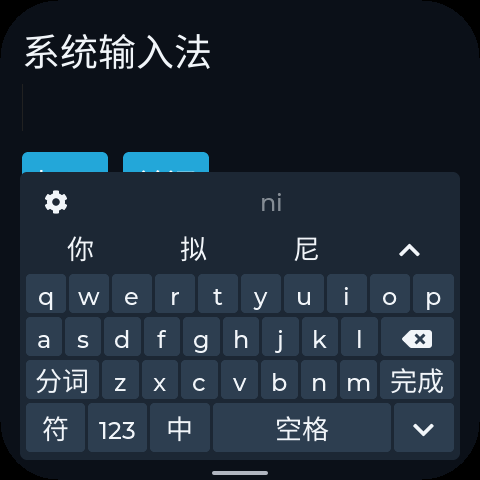
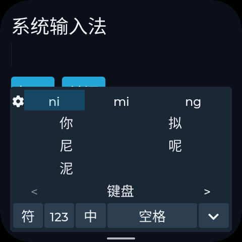
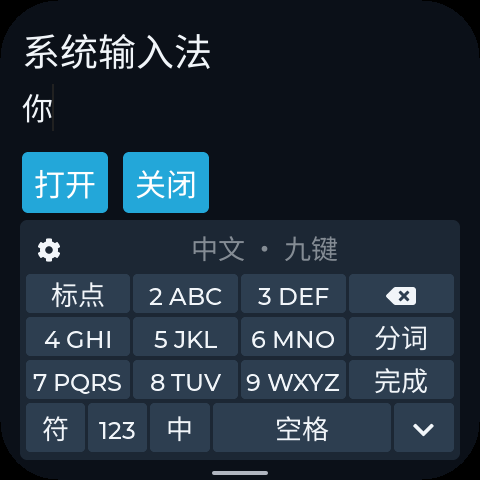
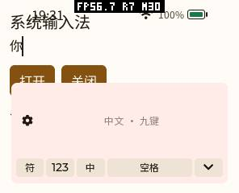
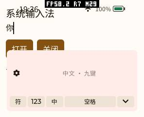
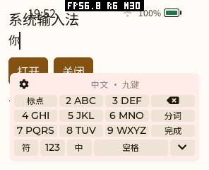

# 候选面板收起与展开按钮触摸区域修复（2026-10-16）

修复两个共用键盘问题：展开候选后选字仍挡住键盘，以及高 DPI 下展开按钮被候选字挤窄。内置、`pinyin-ime` 和 `pinyin-ime-lite` 共用 Host 前端，修改这一处即可覆盖三条路径；Provider 包和 ABI 没有变化。

**已更新 pai-touch 的 Host 固件，并完成内置和轻量 PXA 输入法真机验证。** 本次仅写应用分区，字体、应用包及私有数据保留。设备上的完整版 Provider 此前已归档，本轮保持该状态，其 AOT/Wasm 路径由模拟器覆盖。单独重装输入法 App 不会更新这段共用 UI。

## 提交后恢复键盘

原因是选字后 `expanded` 状态没有清除：候选文字更新了，布局仍保留网格高度，主按键继续隐藏。

现在仅在接受非空 INSERT 事务后收起候选网格，再使用现有的同一次布局更新恢复键盘。部分选择也收起，同时保留尚未提交的拼音及其候选。翻页、切换读音不产生提交，继续保留网格。没有候选的回复退出展开状态，避免空面板覆盖主键区。展开/收起仍复用原按钮矩阵，未添加弹窗或第二层键盘。

回归测试通过真实 LVGL 指针选取展开后的单字、整词及逐字选择，并检查正文、主键可见性和候选栏底边位于按键上方；选择读音、分页时也检查网格保留。修复前原生测试在「主键仍隐藏」断言上失败，修复后通过。

## 展开按钮宽度

原来的展开按钮始终使用权重 1；候选字使用更大的权重，字体/DPI 增大后，按钮的实际点击区域会变得很窄。修复前模拟器的 240×320、160 DPI 配置只剩 **10 px**。

现在先从实际内容宽度中保留展开按钮区域，再安排候选及间隔：

- 优先宽度为 44 dp，极窄布局最多占候选栏的三分之一。该约束针对宽度；高度仍遵循现有小屏垂直预算。
- 空间不足时减少同一行候选数量，剩余候选仍可滑动分页或展开查看。
- 将候选与展开按钮一同换算为 LVGL 的 1–15 权重。高 DPI 下缩放权重单位，避免超过位宽后被截断；按实际间隔计算按钮占比。
- 使用现有文本测量结果和按钮矩阵，没有新增持久状态、动态容器、字体缓存、图层或刷新定时器。

增加实际 esp-mosaico 配置：**480×480、305 DPI、58 px 圆角、四边 12 px 安全边距**。模拟器断言其展开按钮宽度至少 **84 px**，并通过实际点选操作确认可展开、选字后可继续输入。

截图为桌面模拟器输出，用于布局和字形检查，不代表真机 LCD 或触摸延迟测量。普通候选行可能比以前少显示几个字，这是保留点击区域的取舍，候选总数和功能没有减少。

## 验证与资源

| 检查 | 结果 |
|---|---|
| 原生参考键盘、布局、功能与字表回归 | 13 项通过 |
| 原生键盘 ASan / UBSan / LSan | 通过 |
| 关闭内置词库、仅繁体、简繁双字表的原生键盘/功能检查 | 每种 2 项通过 |
| ESP32-S3 生产编译参数下的前端编译 | 通过；未生成或刷写整机固件 |
| 完整与轻量 Provider × AOT / Wasm × 14 种屏幕配置 | **56 组通过** |
| 实际指针选择、单字/整词/部分提交、读音选择、空候选回复 | 通过 |
| 圆屏、圆角、安全边距及高 DPI 的展开按钮宽度断言 | 通过 |
| pai-touch 内置、轻量 PXA 输入法选字后恢复按键、继续输入「你你」 | 通过；每条路径另做 3 次打开/关闭 |

模拟器场景也保留原有切换语言、密码、滑动分页、Provider 故障回退与重复卸载检查。每种正常屏幕配置继续执行 8 次卸载/重启循环。

使用同一同步绘制配置、wrapper、字表和分配跟踪器，仅替换修复前后 frontend 的受控打开/关闭对照如下，单位为请求堆字节，不含 libc 元数据：

| 指标 | 296×240：前/后 | 454×454 圆屏：前/后 |
|---|---:|---:|
| 打开后稳定增量 | 5862 / 5862 | 5902 / 5902 |
| 首次初始化绝对峰值 | 16,794 / 16,794 | 16,810 / 16,810 |
| 重复打开局部峰值增量 | 6887 / 6887 | 6927 / 6927 |
| 关闭差额 | 0 / 0 | 0 / 0 |

这个对照覆盖打开/关闭分配，不是展开、选字时整机峰值或帧率测试；模拟器另外检查 Guest 卸载后的线性内存回收。没有为修复增加默认内存缓存，也不据此声称真机 FPS 或全链路延迟改善。

## 真机更新与边界

共享固件构建目录包含其他任务尚未验收的显示、JPEG、字体及导航改动，不能直接刷入。本次在私有静态库及链接目录中恢复生产基线：全部 6 个加载段与设备备份 `6036e4ca…` 逐字节一致，首段只排除 256 字节的非执行 appdesc。随后只替换 `pxa_lvgl_ime.c.obj`，并核对同一静态库的其他成员未改变。没有修改共享构建产物或撤销工作区中的其他改动。

- 固件：3,444,960 → **3,445,184 B（+224 B）**，增量全部来自 Flash 指令。
- 静态 SRAM data/BSS、IRAM、PSRAM BSS、Flash 只读数据均不变；指令映射仍为 39 页，数据映射仍为 12 页（每页 64 KiB）。
- 最终 IME 固件 SHA256：`51362b62af8fd704eeb7b301cc4453901ffbc2426c8984e9b87944c429500e02`。应用分区写入经 esptool 校验；不包含显示 drain/JPEG 测试候选。
- 字体保持 `121cb206…` 的简体中文/英文版本；原有 21 个安装文件及字体通过设备摘要核对。测试包移除，输入法选择恢复，Wi-Fi 开关恢复开启，保存的网络未删除。

下图来自 pai-touch 的串口触摸注入和 LVGL 帧截图，不是外部相机对 LCD 的测量：

| 路径 | 修复前选字后 | 修复后选字后 |
|---|---|---|
| 系统内置 |  |  |
| 轻量 PXA |  |  |

验证初期曾发生一次解锁、HOME 后启动测试 App 的 `lv_event_mark_deleted` 崩溃，调用栈在原生页面后台重建阶段。脚本在重启后继续发送触摸，误关 Wi-Fi；已经恢复开关，并加入启动完成、画面 OCR、每次输入前后应用运行状态检查，防止触摸落到其他页面。独立重刷原生产镜像与 IME 镜像，各自重做同一冷启动流程均未复现该崩溃。**其原因尚未确定，不宣称已修复，也不将失败那次计入通过数据。** 后续输入检查及恢复检查使用有保护的脚本完成。

测试与失败复现日志、源码摘要及截图见[结果数据](benchmarks/20261016-ime-candidates/summary.json)。回归位于 `ui/reference/tests/reference_ime_test.c` 和 `simulator/desktop/tests/ime_app_test.c`；后者支持已有的完整/单字 Provider、AOT/Wasm 包测试参数。无需修改已安装 Provider 的字典。
