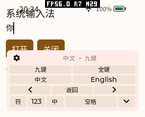
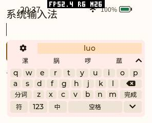
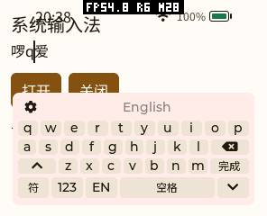

# 内置拼音、字集裁剪与字体验证（2026-10-15 阶段记录）

本文保留首次扩字表阶段的尺寸、固件与设备数据。后续已进一步缩小字体、消除额外 88 B 元数据并完善光标操作，当前版本见[后续验证](input-methods-refinement-20261015.md)。

系统内置输入法已改用完整的规范简体单字表，默认字体按用户选择精简为简体中文、英文及系统符号。齿轮工具页的最后一行增加「← / 返回 / →」，不增加面板行数。pai-touch 已更新正常固件和字体，恢复原有应用；本次临时维护固件和测试 App 均未留在设备上。

## 覆盖与读音

旧 LVGL 示例表共 321 个拼音、1090 个不同汉字、1168 个读音条目，混合简繁字；其中只有 685/3500 个一级规范字、693/8105 个全部规范字，不能满足日常中文输入。

新默认表覆盖 2013《通用规范汉字表》全部 **8105** 字：一级 3500、二级 3000、三级 1605，其中有 196 个补充平面字符。规范表及级别参考[教育部说明](https://www.moe.gov.cn/jyb_xwfb/xw_fbh/moe_2069/s7135/s7562/s7569/201308/t20130827_156353.html)。字符索引与读音来自固定的 [Unicode Unihan 17.0.0](https://www.unicode.org/Public/17.0.0/ucd/Unihan.zip)，对应属性的含义见 [UAX #38](https://www.unicode.org/reports/tr38/)。

简体表有 410 个输入拼写、8461 个读音条目（含 `lue/lve`、`nue/nve` 输入别名）。多音字按规范读音出现，候选顺序优先沿用已授权的旧单字频率，再按规范表序号排列。`ü` 输入为 `v`。不加载词库文件，不复制整表到堆；本地解码器不提供智能词句预测。

可选繁体表有 8833 个不同汉字、415 个输入拼写、9501 个读音条目，覆盖规范字的 Unicode 繁体对应及 Big5 一级常用汉字。每个字使用自己的现代普通话读音，没有把简体的所有读音机械复制给所有变体。保留「后（皇后）」「干（盾牌）」等独立字义；字级对应不等于基于语境的句子转换。`pinyin-ime` 和 `pinyin-ime-lite` 包没有在本次扩充其各自字典。

数据来源、固定摘要和授权在 `tools/ime/`：Unicode License V3 与候选排序数据的 Apache-2.0 均随源码保留。普通构建使用已生成头文件，不访问网络。

## 产品配置与资源

CMake 与 ESP Kconfig 分别控制简、繁两表：

```cmake
PXA_IME_BUILTIN_SIMPLIFIED=ON
PXA_IME_BUILTIN_TRADITIONAL=OFF
```

ESP 对应 `CONFIG_PXA_IME_BUILTIN_SIMPLIFIED`、`CONFIG_PXA_IME_BUILTIN_TRADITIONAL`。只编简体、只编繁体、双表及全部关闭均可构建。全部关闭保留英文键盘；修正了此配置初次打开仍显示旧中文键表的问题。双表初次使用简体，工具页增加简体/繁體选择，切换前确认已有组合。

| 字表 | 只读候选池与索引 | ESP32-S3 对象 rodata | 对象 text | data+bss |
|---|---:|---:|---:|---:|
| 全关 | 0 | 28 B | 2084 B | 0 |
| 简体 | 30,093 B | 30,133 B | 2167 B | 0 |
| 繁体 | 33,102 B | 33,142 B | 2169 B | 0 |
| 双表 | 63,195 B | 63,247 B | 2175 B | 0 |

这是同一 ESP 编译命令只变字表宏的对象测量，不能直接当作最终固件增量。当前正常固件为 **3,442,576 B**；此前已统一键盘、尚未扩字表的历史固件为 3,422,240 B，相差 20,336 B（约 19.9 KiB）。历史固件并非完全隔离全部并行项目变动的 A/B，隔离字表的结论以对象数据为准。

解码状态仍是 64 字符输入、32 个拼写及 12 候选的有界窗口，按需分配，关闭释放；扫描使用缓存的拼写长度，不创建大型索引或临时容器。两表的完整九键编码最大歧义只有 6 个拼写，未超出窗口。未选字表不进入对象。

## 字体不是运行时多层 fallback

产品生成器 `tools/fonts/build_common_font.py` 增加可组合的 `--languages`；构建端裁剪并合并成一份 TTF，设备只复制这一份结果。

| 字体配置 | 最终字节数 | 地区字形 |
|---|---:|---|
| 更新前字体 | 3,879,128 | SC，包含多种旧字集 |
| **简体 + 英文（当前默认及实机）** | **2,805,772** | **中国大陆 SC 黑体** |
| 繁体 + 英文 | 3,149,044 | TC 黑体 |
| 简繁 + 英文 | 3,965,048 | 共同码位用 SC 字形 |
| 日语 + 英文 | 2,245,192 | JP 黑体，JIS X 0208/0201 |
| 韩语 + 英文 | 2,314,140 | KR 黑体，现代 Hangul/Jamo |

均以相同旧字体及固定 Noto TTC 生成。所有配置额外保留从系统资源目录与键盘标签源码收集的 267 个固定 UI 字符，避免非简体字集导致现有菜单或按键显示方框；没有装入另一整套中文字符集合。这些字符已包含在默认简体配置中，因此不会改变已验证的设备字体。默认精简字体有 9883 个码位，完整覆盖 8105 规范汉字和英文；保留系统标点、箭头、图标、温度、版权、乘除号等符号。与原字体相比补入 1347 个规范字，移除 6599 个未选字集码位，节省 **1,073,356 B（约 1.02 MiB，27.7%）Flash**。精简前后共同保留的 8534 个码位在四档字号下像素、字宽与基线全部一致。原有少数格式/组合控制字符本来无独立墨迹，不作为缺字。

保留旧覆盖并补齐简体的替代构建曾为 4,376,852 B；用户已明确选择精简配置，当前默认不保留整套繁体、日语、韩语覆盖。阅读繁体作品或显示其他语言，应改选字集或加入应用 corpus，不应依赖 `.notdef` 猜测显示效果。

繁体数据中 `𡑍𣈶𥗽` 不在所用 Noto CJK 中，构建端可合并 OFL Unifont 三个轮廓；这三字风格与 Noto 有差异，简体默认没有使用。补充字体不复制到设备，也不成为运行时 face。不同 CJK 地区的共同 Unicode 码位在同一字体中只能采用一种字形，缺字 fallback 不能解决按段落的地区字形切换。

这次没有新增逐语言运行时查询链；原有图标和小字号位图 fallback 保留。多字体运行时链在缺字时会依次查询，额外 face 也会占内存，因此没有把它作为只为裁剪设备语言的默认方案。TTF 文件按需读取，文件大小不是常驻 RAM 大小。

实际 FreeType 配对测量（同一保留字符集合、相同加载标记和 12/16/28/56 px）：打开请求堆从 6080 B 到 6168 B，渲染峰值从 67,452 B 到 67,540 B，**增加 88 B**，来自支持补充平面的字体元数据；关闭后均归零。这不是整机 RAM，不能宣称所有内存分类完全不增长。没有第二张帧缓冲、深度缓冲、字体图集或新增常驻加载线程。

生成与裁剪命令、各语言范围及许可见产品仓库 `tools/fonts/README.md`。当前输出 SHA256：

```text
c705d23f6a239e43f21075a660ec2739cf399fd7926140687dc516a3f6e4f698
```

同一命令重复构建，输出逐字节一致。

## 光标按钮与验证

工具页底行复用现有按钮矩阵：「← / 返回 / →」。左右键按 Unicode 字符移动，包含四字节字符；边界夹紧，不拆 UTF-8，不改变正文，面板保持打开以便连点。组合或排队输入会先顺序确认，再移动光标。辅助编辑区的箭头共用这一流程，避免移动时丢失待选拼音。密码模式可移动光标，仍禁止中文解码。

验证覆盖：

- 原生参考 UI 和字表等 **13/13** 回归通过；包含 13 种分辨率、DPI、圆屏/圆角屏及密码模式下的工具光标操作。
- 简、繁、双表、关闭四模式逐字逐读音验证九键/全键、所有候选页及实际 CHOOSE 提交，196 个补充平面字也通过；ASan、UBSan、LSan 无报错。
- 额外的无字表、仅繁体、双表原生 UI 配置各通过键盘及 Feature 测试；默认 UI 也通过 ASan、UBSan、LSan。
- 字体生成器 **5/5** 单元测试通过；8105 简体字在四档字号下 **32,420 次渲染，缺字 0、空白 0**。繁体和双字集逐字渲染通过，日语、韩语样例通过。字体输出的 BMP cmap 映射及完整最佳 cmap 均校验。
- `pinyin-ime`、`pinyin-ime-lite` 分别以原生 AOT 和可移植 Wasm 跑 13 个屏幕配置与 6 个故障包，共 52 个正常配置与 24 个故障包验证，通过。
- pai-touch `/dev/ttyACM0` 真机三种 Provider 都实际提交「你好」；当前内置重复开关 8 次，完整/轻量各 2 次，正常回收并恢复选择。之前统一键盘阶段三种各 8 次的历史数据另存，不与本次样本混淆。
- 真机「luo」滑动至末页，显示并选择原字体缺少的「啰」；输入 `ai` 后从工具页左移，确认「爱」，在正文中插入英文；经左右光标再次插入，最终日志实际提交 **「啰qq爱」**，而非仅依据截图推断光标成功。





以上截图由设备截图接口生成，保留 frame_id、device_us 和来源元数据；本组为 `source=lvgl`，用于 UI 字形及布局检查，不作为 LCD 扫描完成或端到端延迟的证据。截图拍摄均在 MEMORY 局部窗口之外，避免 JPEG 缓冲污染峰值。

## 实机内存口径与恢复

以下是暖启动重复开关窗口中，相对窗口开始的最小空闲堆变化，包含 UI、Guest、前台测试应用及协议活动，不是单独的解码器大小：

| Provider | 循环数 | SRAM 临时峰值增量 | PSRAM 临时峰值增量 | 关闭后 PSRAM 差额 |
|---|---:|---:|---:|---:|
| 内置 | 8 | 164 B | 363,840 B | 36 B |
| 完整 | 2 | 4940 B | 1,620,516 B | 32 B |
| 轻量 | 2 | 4256 B | 349,012 B | 28 B |

内置每次关闭后的空闲 PSRAM在 6,547,072–6,547,076 B 间波动，未出现逐轮累计增长；SRAM 回到 55,579 B。协议/后台分配使整机采样不能解释为严格零差额。原生受控分配跟踪的关闭差额为零。初始化峰值单独保留在 `first-window.json`，旧历史最小值不得拿来代替本次 `MEMORY START` 窗口最小值。

本次完整/轻量 Provider 首次键盘 DRAW_POST_END 为 48/40 ms，候选首次确认在 2488/1128 ms；两者分别是 UI 绘制回调和词典就绪时间，不能作为 LCD 全链路延迟。内置路径不填 Provider 遥测，返回的 0 是未计时，不能称为零延迟。

字体替换遇到的实际限制是 LittleFS VFS 拒绝覆盖打开的文件；原生 UI 和 PXA Host UI 都持有 face，仅停前台应用或只禁用一处加载都不足以安全替换。因此临时维护构建关闭两处字体加载，原子上传并校验，再恢复正常固件。维护修改使用共享固件锁，完成后源文件恢复，没有提交维护开关。

设备只更新 factory **应用分区 0x10000**，不擦除分区表、Wi-Fi 或用户私有数据。为腾更新与测试空间曾临时 archive 包，最终原浏览器 bench-menu 测试包和两款输入法已恢复，manifest 与签名逐项比对一致。测试 fixture 卸载、内置选择恢复、系统文件锁定、MEMORY 停止、无 App 运行，已向浏览器任务释放设备继续同固件基线。

最终正常固件 SHA256：

```text
42256b9fb7f4defbc6f897bec2b0356eef3b22e004bc5651d95a14f67d8eae5d
```

原始 JSON、测试日志、图像、尺寸与来源摘要见 [验证数据](benchmarks/20261015-ime-characters/summary.json)。全 Flash 备份和私有 NVS 不在文档目录中。当前结论只覆盖上述设备和样例；不同字体/语言组合与不同产品的性能，仍需按相同口径实测。
