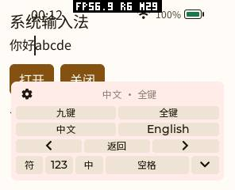
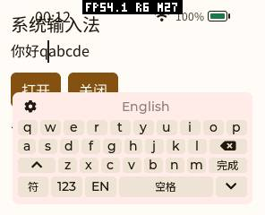
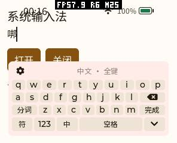

# 字体精简与光标操作后续验证（2026-10-15）

这一轮继续完善上一阶段的内置输入法和按语言裁剪字体。默认仍为简体中文、英文及必要系统符号，全部 8105 个规范汉字保留。源码和工厂字体已更新，本地验证及 **2026-10-16 pai-touch 真机更新与复测已完成**。新字体、正常固件已安装，原有应用和数据已恢复核对，ACM0 已交还浏览器任务。

此前已经完成并真机验证的完整字表、三种 Provider 共用键盘、工具页光标按钮，见[上一阶段记录](input-methods-character-coverage-20261015.md)。本文不把上一阶段的设备数据当成本轮新镜像的实测结果。

## 光标操作

工具页和辅助编辑区的左右箭头都改为按下即移动、长按重复，抬手不再额外移动一次。普通字母及布局切换仍保留原有触发方式。左右移动按 Unicode 字符计数，包含四字节汉字；已有拼音或排队输入先确认，再移动插入位置。

到达文本边界后，不再重复重启输入法会话或刷新辅助编辑区。实际移动时仍重置 Provider 的上下文，保持光标位置与解码会话一致。复用现有按钮矩阵与定时器，没有增加面板行数、状态字段、后台线程或缓存。

原生回归不仅调用内部事件，也通过 LVGL 指针实际按住按钮，验证按下即时移动、两次重复及抬手不多移；同时覆盖中英文、补充平面字符、边界、组合确认、密码模式和 13 种屏幕配置。

## 字体与生成器

有补充平面字符时，输出只保留一个完整的 format 12 Unicode cmap，同时包含 BMP 与补充平面映射；仅 BMP 的语言配置保留紧凑 format 4。[OpenType 规范](https://learn.microsoft.com/typography/opentype/spec/cmap#format-12-segmented-coverage)允许省略供旧软件使用的 format 4 副本。PXA 使用的 FreeType 以及生成标签所用 Pillow 均已验证；不承诺只识别 format 4 的旧工具兼容性。

默认字体除 `cmap` 和文件校验字段外，其余表与上一阶段逐字节一致，完整映射表内容也保持一致。因此这一轮没有再次转换默认 SC 轮廓，没有降低字号、抗锯齿或字形质量，没有加入运行时逐语言 fallback。

| 配置 | 上一阶段 | 本轮 | 变化 |
|---|---:|---:|---:|
| 简体、英文 | 2,805,772 B | **2,777,480 B** | −28,292 B |
| 繁体、英文 | 3,149,044 B | 3,113,972 B | −35,072 B |
| 简繁、英文 | 3,965,048 B | 3,928,928 B | −36,120 B |
| 日文、英文 | 2,245,192 B | 2,245,192 B | 0 |
| 韩文、英文 | 2,314,140 B | 2,314,140 B | 0 |

均使用上一阶段相同的原字体和固定 Noto TTC 构建。默认相对最初 3,879,128 B 的工厂字体，共节省 **1,101,648 B（约 1.05 MiB）**，仍保留 9883 个码位、9851 个轮廓，以及全部 8105 个规范汉字。UI 固定标签、标点、箭头和图标仍保留。默认输出 SHA256：

```text
121cb206d826af5259cfb78418defde651a9daa80fa1d7d51de3eea716c934a4
```

生成器同时修复三类边界问题：

- 选择 SC 时，不能继续沿用 TC/JP base 的 CJK 轮廓后只改字体名称；切换地区会从所选源 face 重建相应字形，同地区才保留原轮廓。
- 有效字符即使轮廓和度量与 `.notdef` 完全相同，也不会去重到 glyph ID 0，避免被字体引擎判为缺字。
- 先写临时文件、完整校验、关闭输入句柄，最后原子替换输出。失败保留原文件，保留原文件权限（新输出继承 base 权限），支持 base 原位更新并记录替换前摘要，拒绝覆盖源字体或 corpus；摘要计算采用流式读取。

FreeType probe 现在会对缺字返回失败，严格拒绝无效 UTF-8，并在错误路径关闭文件和 face。以前仅检查像素差异、未让缺字导致非零退出，容易把有方框的字体误判为通过。

## 内存与性能口径

同一保留字符集合、同一 FreeType 加载标记、12/16/28/56 px 的配对结果如下；这是请求字节，不包含分配器元数据、LVGL 字形缓存和整机堆。

| 指标 | 上一阶段字体 | 本轮字体 | 变化 |
|---|---:|---:|---:|
| 打开后请求堆 | 6168 B | 6080 B | −88 B |
| 同样本渲染峰值 | 67,540 B | 67,452 B | −88 B |
| 关闭后未释放 | 0 | 0 | 0 |

8534 个共同码位在四档字号下共 34,136 次比较，像素、字宽、基线均一致。默认 8105 个规范汉字另做 32,420 次渲染，缺字 0、空白 0。繁体和双字集做全字集渲染，日文、韩文做覆盖校验和样例渲染。

键盘前后对照固定使用同一 wrapper、字表、位图字体、布局、帧缓冲和分配跟踪器，只替换本轮修改的 frontend。桌面默认独立绘制线程使临时分配峰值随生产/消费时序变化，同一可执行文件重复运行也会波动，不能把单次峰值差当作版本差异。受控对照使用同步绘制配置，固定 tick，每种形状、每个版本重复 5 次；所有重复一致：

| 请求堆指标 | 296×240 圆角矩形：前/后 | 454×454 圆形：前/后 |
|---|---:|---:|
| 打开后稳定增量 | 5862 / 5862 B | 5902 / 5902 B |
| 首次初始化绝对峰值 | 16,794 / 16,794 B | 16,810 / 16,810 B |
| 重复打开局部峰值增量 | 6887 / 6887 B | 6927 / 6927 B |
| 关闭后差额 | 0 / 0 | 0 / 0 |

首次峰值包含 LVGL 初始化，重复打开峰值相对该次窗口开始，二者不能直接相减。同步对照用于隔离 UI 分配，不代表设备 PSRAM 或完整显示流水线的峰值。

同一 ESP32-S3 编译命令的 frontend 对象：text 从 21,134 到 21,252 B（+118 B），literal 从 3420 到 3448 B（+28 B），指令与常量池合计增加 146 B；rodata 16,663 B 不变，data/bss 及额外 DRAM/IRAM 段均为 0。最终正常应用镜像为 **3,444,960 B**，相比上一阶段增加 2384 B；包含其间其他共享源码变更，不能将整个增量归因于输入法，对象结果才是本轮代码改动的隔离测量。早先准备的 3,442,704 B 镜像没有作为最终部署版本。

输入法和字体改动没有新增默认缓存、额外帧缓冲、Guest 线性内存或命令队列。本轮没有测得整机 FPS 或输入到 LCD 的延迟收益，不将减少边界重置和字体元数据据此换算为帧率提升。真机 SRAM/PSRAM 的运行窗口峰值另列于下文。

## 回归与复现

- 原生参考 UI、布局、功能裁剪及字表等 13/13 通过；无字表、仅繁体、双表配置分别通过键盘及 Feature 检查。
- 默认键盘 ASan、UBSan、LSan 通过，包含光标长按和边界断言。
- 字体生成器及原生 probe 共 11 项测试通过，probe 同时启用 ASan、UBSan、LSan；包含非法 UTF-8、缺字失败、地区选择、补充平面、失败回滚及原位生成。
- 完整与轻量 Provider 各以 AOT/Wasm 跑 13 个正常屏幕配置、6 个故障包，共 52 个正常配置和 24 个故障包验证通过。
- 默认字体重复生成逐字节一致；繁体、双字集、日文、韩文及 TC→SC 重新生成均通过验证。TC→SC 用于验证地区切换，并非声称转换后的轮廓与旧 SC base 像素一致。

字体的构建、裁剪及 probe 命令见产品仓库 `tools/fonts/README.md`。同步键盘对照可在产品仓库根目录运行：

```sh
bench=deps/pxa-system/docs/zh-CN/benchmarks/20261015-ime-refinement
cmake -S "$bench/native" -B /tmp/pxa-ime-memory-build -G Ninja \
  -DCMAKE_BUILD_TYPE=Release \
  -DLVGL_SOURCE_DIR="$PWD/firmware/managed_components/lvgl__lvgl"
cmake --build /tmp/pxa-ime-memory-build --target pxsys_reference_ime_test -j 6
python3 "$bench/run-paired-memory.py" \
  --build /tmp/pxa-ime-memory-build --output /tmp/pxa-ime-memory-result
```

脚本校验本轮 frontend 摘要，再反向应用保存的补丁构造前一版本；源码改变后会要求重新建立基线，不会悄悄拿不同工作负载比较。`--threaded` 可配合正常模拟器 Ninja 构建记录绘制线程的波动，只对稳定占用和关闭差额断言相等。

文档中的独立 CMake 工程已从头构建，键盘回归与配对内存脚本均实际运行通过。原始数据、构建报告、测试日志和隔离对象数据见[验证数据](benchmarks/20261015-ime-refinement/summary.json)。

## pai-touch 更新、操作与内存

浏览器任务明确释放 ACM0 后，先核对原浏览器和两款输入法的 **24 个安装文件**，保存与当时设备逐项匹配的签名目录；原浏览器是正常首页版，不是旧 bench-menu 测试版。先在更新前补测内置输入法，再用维护启动关闭两处字体 face，上传并校验字体、NOTICE 和 OFL，最后恢复当前工作区构建的正常固件。仅刷写应用分区 `0x10000`，没有擦除数据或 Wi-Fi。

三种 Provider 均实际提交「你好」，并分别完成长按光标测试：输入「你好abcde」，在中文模式长按左箭头到开头，右移两次，再切英文插入 `q`，最终日志均实际提交 **「你好qabcde」**。这同时验证 Unicode 光标计数、按下响应、持续重复、抬手不额外移动，以及外部 Provider 会话重置。内置还滑动候选、显示并实际提交「啰」和四字节汉字 **「𠳐」**。





图像来自设备截图接口，元数据为 `source=lvgl`，用于字形和布局验证；不能作为 LCD 扫描完成或光电延迟的证据。所有 JPEG 均在 MEMORY 局部窗口之外抓取。

以下为各次 `MEMORY START` 运行窗口中，相对开始时空闲堆的最大减少量，包含前台 fixture、UI、Provider 和协议活动，不是解码器单独大小。首次前台启动与重复开关分别记录，未使用历史累计最小值替代局部峰值：

| 阶段 / Provider | 重复开关 | SRAM 局部峰值增量 | PSRAM 局部峰值增量 | 关闭后 SRAM / PSRAM 差额 |
|---|---:|---:|---:|---:|
| 更新前内置 | 8 | 164 B | 365,588 B | 36 / 52 B |
| 更新后内置 | 8 | **164 B** | **363,884 B** | **0 / 24 B** |
| 更新后完整 | 2 | 4940 B | 1,616,956 B | 0 / 28 B |
| 更新后轻量 | 2 | 4256 B | 339,232 B | 0 / 28 B |

更新后内置每次关闭的空闲 SRAM 为 55,635–55,671 B、PSRAM 为 6,581,476–6,581,480 B，8 次样本未出现逐轮持续减少。几十字节差额和 SRAM 的 36 B 波动包含协议/系统后台活动，不能称为严格零泄漏。受控原生 UI 的关闭差额为零，完整/轻量仅两次循环也不足以推断任意长时间运行的行为。

首次「前台 App 启动＋首次键盘打开」窗口，更新前内置的 SRAM/PSRAM 峰值增量为 5292 / 777,580 B，更新后为 5420 / 788,012 B，分别高 128 / 10,432 B。旧固件已经长期运行，新固件重新启动，字体/页面缓存冷热不同，最终固件也含并行变更；**这不是严格隔离的首次初始化 A/B，不能据此宣称整机首次峰值不增长**。可隔离的本轮 frontend 首次峰值与稳定占用不变、FreeType 请求堆减少 88 B，证据分别见上文受控测试。整机首次窗口差异仍需在相同固件和缓存状态下单独测量。

更新后完整/轻量 Provider 首次 `DRAW_POST_END` 为 30 / 20 ms，词典候选就绪为 2236 / 944 ms。前者是 UI 绘制回调，后者含 Provider 装载，均不是输入到 LCD 的全链路延迟；内置路径未填此遥测，零值不代表零延迟。

## 恢复与已知限制

完成后卸载本轮 fixture，恢复原有三款应用。浏览器 10 个文件和两款输入法共 24 个文件再次逐项 FSSHA 匹配，默认内置选择和 FSLOCK 恢复，没有 App 运行，MEMORY 停止，串口无占用，已明确交还浏览器任务。应用私有文件集合与维护前一致，Wi-Fi 配置未执行修改。

最终固件 SHA256：

```text
2888648beb53b8db69e85d16e01dad86b8df2f7d3dba92a158c092a2efa27fe4
```

设备 hello 为 `host-tools-v0.1.0-23-g586e1db-d`。文件摘要、恢复标记及主页截图见[设备最终状态](benchmarks/20261015-ime-refinement/hardware/device-final.json)。

本次还遇到 LittleFS 可用空间统计限制：恢复浏览器前，可见文件总计 4,753,367 B，正常启动却报告 used 7,708,672 B、free 1,728,512 B，安装工具因此拒绝上传。切换到关闭字体 face 的维护启动，同一文件集合报告 used 4,931,584 B、free 4,505,600 B，足够恢复原包，再回到正常固件。差额与字体占用接近；LittleFS 的遍历允许打开文件被重复计数，具体是否由 dusty 文件状态引起尚未完全隔离。**没有据此删除原有用户数据，也没有修改底层统计或跳过容量检查**。这是仍需单独修正的容量口径问题，不能把统计差额当成真实磁盘泄漏或字体 RAM 消耗。

后续字体安装仍须先关闭原生 UI 和 Host UI 持有的 face，再原子上传和校验；不能在打开的字体文件后直接截断写入。维护镜像和私有备份未放入公开验证目录，原始硬件结果见 `benchmarks/20261015-ime-refinement/hardware/`。
