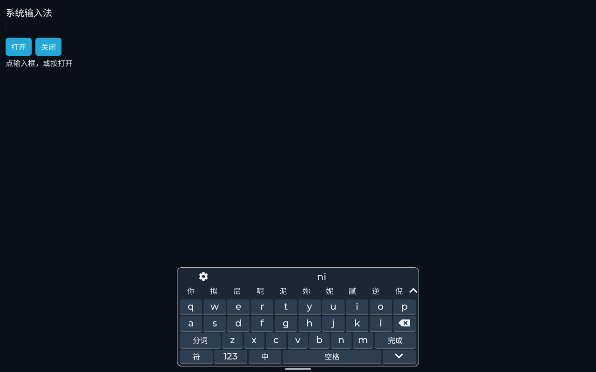
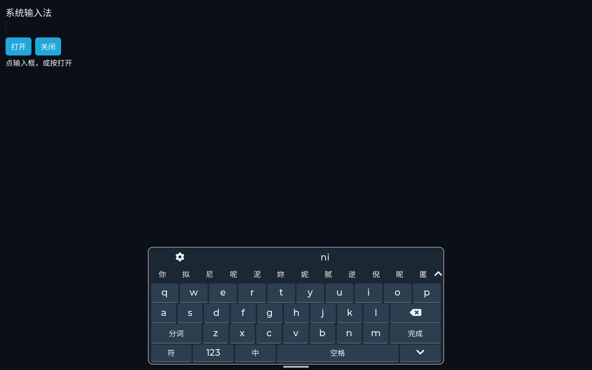
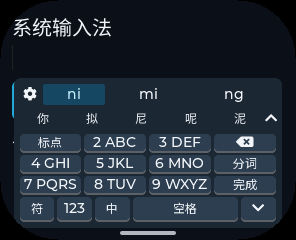
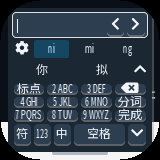
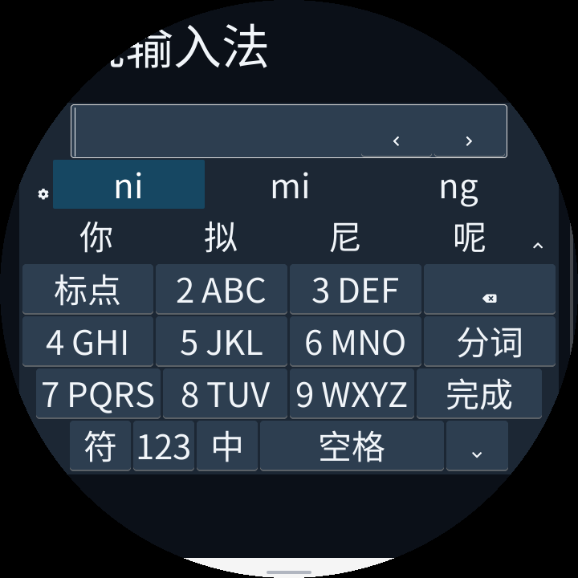
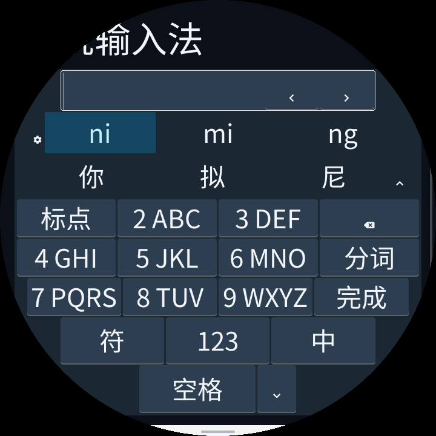
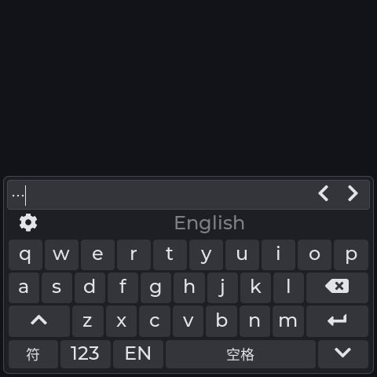
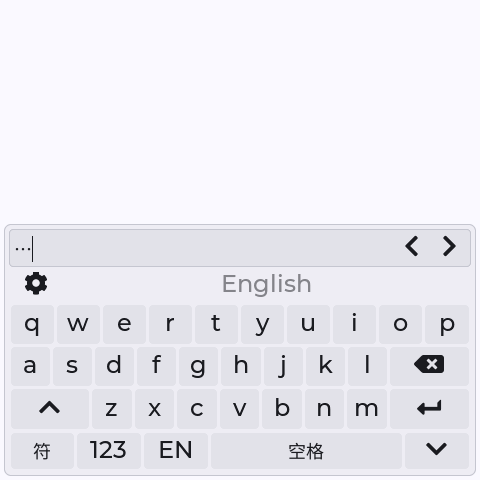
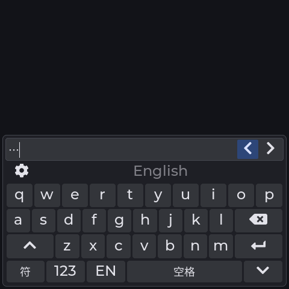

# 输入法触摸体验与屏幕适配验证（2026-10-15）

本轮修改 Host 手机键盘的操作与布局，完整版 `pinyin-ime` 和轻量版 `pinyin-ime-lite` 共用这些改进。输入法包、词库和 IME ABI 均不需要迁移。原生紧凑内置键盘另外修复删除响应；原生桌面系统页、宽屏内置键盘及 Provider 故障后的 LVGL 键盘仍使用原有布局，不能将手机键盘的全部改进算到这些路径。

## 操作变化

| 问题 | 修改 | 验证 |
|---|---|---|
| 删除要等到松手才响应 | 删除按下即生效、按住重复、松手不再删除；全键删除键加宽 | 中文与英文正文的真实 pointer down/up；英文长按；原生紧凑键盘中文、英文、数字模式 |
| 长按空格拖出底栏后光标控制中断 | 长按高亮并锁定当前触摸，跨相邻按钮及移出底栏仍可拖动，结束后释放锁定 | 固定多行编辑器中移动原光标；正文不变；释放后不收起、不切换面板 |
| 候选展开需要精确点击小箭头 | 候选上滑展开、下滑恢复键盘，保留组合与原入口 | 两方向真实拖动，断言没有提交候选或误按主键 |
| 拼音与候选的滑动区域判定依赖近似字号 | 按实际候选行高判断手势起点；12 dp 阈值受宽度限制，移动方向需满足 3:2 优势 | 九键读音横滑、词页横滑、候选展开/收回；完整字母表及工具入口仍可用 |
| 大屏按键偏小 | 优先行高 36→44 dp，面板宽度上限 520→640 dp，底栏优先 40 dp；按可用空间压缩 | 大屏键区变大，小屏保留紧凑布局；逐个检查可见子区域四角处于安全轮廓内 |
| 圆屏底部弧形区域未利用 | 空间足够时，上行符号/数字/语言，下行空格/收起；主键不动，底部按弦宽收窄 | 同一个按钮矩阵、无新增控件；逐个检查实际可见按钮，点击隐藏侧格不提交、不收起 |
| 小屏九键字母标签拥挤 | 限制拉丁字号；极窄屏用预生成的窄体 ASCII，中文大小不变 | 逐个检查全部九键分组、分词、完成及空格的真实文字宽度 |
| 每次候选回复都重装静态键表 | 按只读 map 指针复用主键与底栏；字体/环境变化时失效并即时重排 | 中英文、大小写、数字、符号、密码、环境更新、已打开时切换字体后立即实际点击 |

按压与选中状态复用同一个强调样式，文字使用对应前景色；候选栏的固定外观改用共享只读样式。没有新增弹窗、输入法专用线程、字形图集、帧缓冲或每实例键表缓存。圆屏两侧隐藏单元的宽度用一个字节记录，位于结构体原有对齐空隙，不增加结构体大小。开键盘后才加载词库的机制保持原有实现；本轮没有测量新的开屏速度或宣称词库初始化更快。

## 屏幕与画面

对两个签名 Provider 分别运行相同的 13 组 SDL 产品模拟器配置。表中的 DPI 是模拟环境提供的密度，不是实物屏幕标定值。

| Profile | 分辨率 | DPI | 形状与边距 |
|---|---|---|---|
| 0 | 240×320 | 160 | 矩形 |
| 1 | 480×480 | 320 | 圆角矩形，圆角 48 px |
| 2 | 454×454 | 160 | 圆形，安全边距 24 px |
| 3 | 390×844 | 160 | 矩形竖屏 |
| 4 | 296×240 | 160 | 圆角 58 px，左右 10 px、上下 8 px |
| 5 | 160×160 | 160 | 圆角 40 px，安全边距 4 px |
| 6 | 240×240 | 480 | 圆形，安全边距 4 px |
| 7 | 320×180 | 320 | 横屏，圆角 20 px、安全边距 4 px |
| 8 | 1280×800 | 160 | 大屏矩形，安全边距 8 px |
| 9 | 720×720 | 480 | 圆形，安全边距 16 px |
| 10 | 320×320 | 640 | 圆角 80 px，安全边距 8 px |
| 11 | 800×480 | 240 | 四角半径 0/96/56/4 px，安全边距 8 px |
| 12 | 160×320 | 320 | 中央直径 160 px 圆形可见区，安全边距 4 px |

同时检查空闲/组合时主键位置稳定、全 QWERTY 字母齐全、分词/完成标签不截断、删除/回车/收起不重复、密码掩码。滚动容器临时露出当前编辑行，关闭恢复滚动；固定/浮动编辑器使用现有当前行辅助区，验证移动光标与正文同步。

1280×800 大屏的可用键区宽度从 510 px 增至 630 px，三行总高从 108 px 增至 132 px，即每行 36→44 px。296×240 小屏实测三行仍各 21 px，没有为了统一按钮尺寸进一步挤压编辑区。720×720 圆屏三行的坐标与尺寸和修改前完全相同，底栏增加一行并延伸到约 y=681，原来约 y=602 以下的部分空白得到利用。极小屏和极高密度组合受物理面积限制，仍建议自动/九键布局；没有宣称任意屏幕都能提供完整尺寸的 QWERTY 触摸目标。

### 大屏，修改前 / 后





### 小圆角屏，修改后



160×160 边界配置，窄体拉丁字形保持数字和完整字母组，中文保留原字号：



### 圆屏，修改前 / 后





## 重复工作与内存

本节是触摸与圆屏布局阶段的历史测量，不包含下文后续配色修正，也不将后续重新编译包的 WAMR 数据混入此前的对照。

独立 Host 诊断程序使用同一套当前 LVGL/Host 库，分别编译修改前的 `pxa_lvgl_ime.c`（Git blob 前缀 `234ef9d`）与修改后文件。480×480、160 DPI、全键中文、固定一个候选，预热后重复呈现相同候选 1000 次；矩形和圆形各独立启动。只在诊断程序中统计 IME 发起的 `lv_buttonmatrix_set_map`，并用链接器 malloc/calloc/realloc/free 包装统计静态链接代码申请的活跃字节与本段峰值。

| 项目 | 修改前 | 修改后 |
|---|---:|---:|
| 矩形 map 重装次数 | 3000 | 1000 |
| 圆形 map 重装次数 | 5000 | 1000 |
| Host IME 结构体，桌面构建 | 1168 B | 1168 B |
| 矩形稳定申请量 / 本段峰值 | 14666 / 14779 B | 14580 / 14693 B |
| 圆形稳定申请量 / 本段峰值 | 17377 / 17546 B | 17331 / 17500 B |
| 矩形 / 圆形申请次数 | 1000 / 7000 | 1000 / 7000 |

这些是该桌面诊断工作负载的统计，包含显示/编辑器/键盘，并非单个 IME 的全部占用。矩形稳定量和峰值各少 86 B，启用双行底栏的圆形各少 46 B。未包含共享库内部申请、分配器元数据、设备 SRAM/PSRAM 和 LCD DMA；峰值从预热后开始重置，**不包含初始化**。map 计数减少不表示端到端延迟按相同比例减少，也没有将申请次数没有降低说成减少了动态分配。

新增极窄屏 ASCII 字体有 3,370 B A8 像素，桌面构建含描述合计 4,472 B，只读映射；圆屏键表和共享只读样式也增加少量只读数据。实现代码也有所增加。运行堆未增长不代表固件体积、代码映射不增长；本轮未测设备链接映射和整机启动峰值，不能据此推算整机 SRAM/PSRAM 数据。

真实签名完整版 Provider 的 13 组前后内存快照全部一致。以下为 Profile 8 的同场景数据，WAMR 计数与线性内存分开列出：

| 项目 | 修改前与后 |
|---|---:|
| 空闲 / 已加载 / 关闭后 WAMR 申请量 | 32235 / 88915 / 32235 B |
| 本次进程 WAMR 峰值，含初始化 | 111701 B |
| 空闲 / 已加载 / 关闭后 Guest 线性内存 | 131072 / 1376256 / 131072 B |
| 本次进程 Guest 线性内存峰值，含初始化 | 1376256 B |
| 已加载 / 关闭后代码资产临时缓冲 | 0 / 0 B |

每个正常 Provider 测试还覆盖 8 次卸载/重启，以及等待回复时队列背压、提前输入、切换中英文、Provider 超时、密码上下文变化和编辑器先于键盘删除。

## 复现与结果

SDK 目录中执行，`PXA_APP_SOURCE_ROOT` 指向独立的 pxa-apps，LVGL 路径替换为本地兼容版本。签名私钥应与待测 Provider 使用的私钥一致。

```sh
cmake -S simulator/desktop -B out/ime-ux -G Ninja \
  -DCMAKE_BUILD_TYPE=Release -DPXSYS_BUILD_TESTS=ON \
  -DPXSYS_LVGL_SOURCE_DIR=/path/to/lvgl \
  -DPXSYS_DESKTOP_APP_SOURCE_ROOT=/path/to/pxa-apps
cmake --build out/ime-ux --parallel 6 --target \
  pxsys_ime_test pxsys_reference_ime_test pxsys_reference_layout_test \
  pxa_ime_test pxa_ime_preferences_test
ctest --test-dir out/ime-ux --output-on-failure \
  -R '^(pxa_ime_test|pxa_ime_preferences_test|pxsys_reference_layout_test|pxsys_reference_ime_test)$'

bash tools/package/test_cpp_ime_app.sh out/ime-ux/pxsys_ime_test \
  /path/to/signed/pxa-pinyin-ime /path/to/publisher-private.pem
bash tools/package/test_cpp_ime_app.sh out/ime-ux/pxsys_ime_test \
  /path/to/signed/pxa-pinyin-ime-lite /path/to/publisher-private.pem \
  --single-character-provider
```

两种 Provider 各通过 13 组配置及 6 种坏包/缺文件/多文件/符号链接/硬链接等故障验证，故障能退回原生键盘，前台应用不退出。另通过上述 4 个 CTest；轻量引擎和 T9 测试通过 ASan/UBSan、完整字表校验及 10000 次压力输入。

实测环境为桌面 SDL 产品模拟器，没有烧录设备。屏幕截图、触摸坐标与编辑行为已经核对；实物触摸采样率、LCD 扫描、手指接触面积与操作舒适度仍需真机体验验证。这里没有报告新的真机 FPS、开屏耗时或触摸到像素延迟。

## 后续配色修正

键盘边缘、当前行辅助框、按键边缘和输入法设置列表分隔线改用系统 `outline-variant`；设置页的布局/语言下拉框、弹出列表、焦点和选中行均跟随系统主题，移除 LVGL 默认白色边框与选中背景。设置页底部操作说明及对应中英文资源已删除。

重新通过 13 组产品模拟器配置及 6 类 Provider 故障回归，以及 `pxsys_system_gestures_test`、`pxsys_reference_ime_test`。另实际渲染并检查深色/浅色主题的设置页、打开的下拉列表和正在编辑时切换主题的键盘，共六张截图。本次仍未烧录设备；没有把此前的内存数字当作配色修正后的新测量。

## 后续管理列表修正

「管理已安装输入法」现在请求输入法专用筛选，页标题与空列表提示也改为输入法文案。筛选在后端截取容量前进行，依据包中的 IME Provider 声明，包含已停用但仍安装的输入法；普通应用管理继续请求完整列表。桌面用已有应用 flags 保存分类，ESP 用包目录已有标记，不额外加载 Guest 或分配每应用分类缓存。

通过 `pxsys_system_gestures_test`、`pxsys_pxa_binding_test`、`pxsys_pxa_catalog_test`。新增回归覆盖普通应用数量超过界面容量时仍列出两个输入法、停用后重新启用、再次停用、逐个确认卸载、空列表、返回输入法页，以及普通应用管理仍显示普通应用。

另使用真实签名的完整版、轻量版输入法和跳一跳包建立隔离的桌面安装目录，停用轻量版，额外注册 50 个普通原生应用。实际桌面包扫描与列表后端返回两个输入法，启用/停用各一个；计数正确，输出容量为 1 时仍能找到输入法。三个设备端改动文件 `pxa_host.c`、`pxa_esp_host.c`、`pxa_integration.cc` 使用 pai-touch 的实际编译参数通过 ESP32-S3 交叉编译。本次没有烧录设备，也没有测试应用商店的更新流程。

## 后续按钮外观与重绘优化

当前行右侧光标箭头的底边主要来自 LVGL 默认按钮阴影。Host 手机键盘现在移除按钮矩阵的默认主题样式，完整提供自己的系统配色、禁用文字和即时按压高亮；箭头常态透明、无边框、无阴影，按住才出现强调色。主键区也使用平面的圆角填充，减少阴影绘制，不增加合成层或帧缓冲。原生备用键盘和系统其他页面继续使用各自的样式。

| 原因 | 修改与收益 | 内存影响与验证 |
|---|---|---|
| 默认主题的阴影叠加在系统配色上 | 私有矩阵只保留自己的完整样式；箭头复用只读文字栏样式 | 共享禁用样式为只读常量，减少每个矩阵保留的样式；检查深色、浅色和按压画面 |
| 每次回复设置相同面板样式，导致整块键盘无效化 | 固定内边距、边框和不透明度只在主题/屏幕环境更新时设置 | 没有新增状态缓存；环境、字体热更新及实际按键回归通过 |
| 空闲栏反复重装 map、底栏反复写禁用状态 | 复用只读 map，仅在状态变化时写控制位 | 无新增容器；相同空闲回复的基准从整面板刷新变为零刷新 |
| 重复刷新当前行，同样的文字也重新设置标签 | 去掉回复处理中的一次重复刷新，布局完成后同步当前行；构造原有有界缓冲时逐字节判断变化，仍更新光标位置 | 继续使用原有 257 B 缓冲，没有第二份文字缓存；同位置中文替换、清空、密码、光标与换行回归通过 |

深色、浅色及按压状态：







### 绘制对照

本节单独比较这轮修改前后的适配器快照，不混用前面几轮的结果。两份实现链接同一套 O3 桌面 LVGL/Host 库。Linux x86-64，480×480、160 DPI、XRGB8888、矩形/圆形，固定文字 `abcdefghi`、全键中文、已显示当前行辅助区。预热后每项运行 32 次，交替先后顺序取 5 个独立进程样本的中位数；每次调用 `lv_refr_now`，实际执行布局和软件光栅化并累计 flush 像素。重复候选回复固定为拼音 `ni`、候选 `a`；光标在短文本内两个相邻位置移动。强制整面板重绘用于观察样式本身的成本。

计时使用进程 CPU 时间，包含 LVGL 绘制线程，未开启申请追踪。没有推进 LVGL 时钟，因此不包含光标闪烁、定时器和动画调度，也没有 Guest、词库、触摸采样、LCD/DMA。模拟器负载和 CPU 频率仍会影响耗时；这些数字不是实机 FPS 或端到端输入延迟。基准默认位图字体也不能代表实际中文 FreeType 排版成本。

| 工作负载 | 矩形 CPU μs/次，前→后 | 圆形 CPU μs/次，前→后 | 32 次 flush 像素，矩形；圆形 |
|---|---:|---:|---|
| 相同候选回复 | 12207.6 → 703.5 | 8861.9 → 414.8 | 4259328 → 1064448；4712448 → 958464 |
| 相同空闲回复 | 11200.5 → 3.8 | 9329.1 → 6.9 | 3715584 → 0；4168704 → 0 |
| 移动光标 | 564.7 → 364.5 | 239.0 → 199.0 | 323504 → 8080；274608 → 8080 |
| 强制整面板重绘 | 9399.2 → 7675.0 | 10059.2 → 5694.2 | 两种形状的刷新像素均相同 |
| 箭头状态切换绘制 | 198.6 → 105.4 | 174.5 → 96.8 | 两种形状的刷新像素均相同 |

候选场景的刷新像素减少 75.0% / 79.7%，光标场景减少 97.5% / 97.1%。空闲结果表示**收到不改变状态的回复后无需重画**，不是声称输入法正常闲置时此前一直整屏刷新。真正变化的候选仍重建自己的 map；没有为消除这部分工作引入候选缓存。

### 内存与复现

内存另起进程测试，每项 32 次、一个样本，不采用其被追踪器扰动的计时。链接器包装静态链接代码的 malloc/calloc/realloc/free，并用互斥锁保护主线程和 LVGL 绘制线程的计数。稳定值取预热后、本段开始前；初始化峰值和本段峰值分开记录，下表峰值为五项独立运行中观察到的最大值，不是历史累计计数。

| Host/LVGL 申请字节 | 矩形，前→后 | 圆形，前→后 |
|---|---:|---:|
| 预热后的稳定值，含当前行辅助区 | 16047 → 15560 | 17071 → 16328 |
| 初始化与预热峰值 | 30341 → 25622 | 31843 → 26439 |
| 本段绘制峰值 | 30389 → 25893 | 31304 → 26608 |

五个场景各自的初始化峰值和本段峰值均未增长。诊断结构体仍为 1168 B；未绘制、没有辅助区的原始 1000 回复检查也通过，稳定量分别从 14598→14223 B、17358→16615 B。没有新增 Guest 内存、队列、字形图集或生产绘制缓冲；基准双方相同的 19200 B 静态分块绘制缓冲不计入申请量。申请追踪不含分配器元数据和共享库内部申请，也不包括 ESP SRAM/PSRAM、代码映射或 LCD 内存，不能据此声称已测量整机峰值；只读样式和实现代码也有变化，未测设备链接映射。

可复用工具为 `tools/benchmarks/ime_render.py`，仅按需编译桌面诊断程序，不进入产品构建。基准的申请追踪表只存在于 `--memory` 诊断进程。原始样本与源码哈希见 [JSON](benchmarks/ime-render-20261015.json)；本轮单独的 [适配器补丁](benchmarks/ime-render-20261015.patch) 可以从本轮最终源码反向恢复对照快照，SHA-256 为 `5f80cd533a9b8c342db3c78130578092d84c3fd819e79b4738418c753efb7a59`。最终适配器为 `6a67600c3a840290b3ff973c18b03878435abb3f4cca1f671459bfbe4a3f12e0`；后续源码变化时应重新选择对照，不强行套用本表。

在 SDK 目录执行，沿用前面已构建 `pxsys_ime_test` 的 Linux/Ninja 目录：

```sh
ime_benchmark_dir="$(mktemp -d)"
cp libpxa/adapters/lvgl/pxa_lvgl_ime.c "$ime_benchmark_dir/before.c"
patch -R "$ime_benchmark_dir/before.c" docs/zh-CN/benchmarks/ime-render-20261015.patch
python3 tools/benchmarks/ime_render.py --build-dir out/ime-ux \
  --baseline-source "$ime_benchmark_dir/before.c" --output-dir out/ime-timing
python3 tools/benchmarks/ime_render.py --build-dir out/ime-ux \
  --baseline-source "$ime_benchmark_dir/before.c" --output-dir out/ime-memory \
  --memory --samples 1
```

最终版本的完整版、轻量版 Provider 均通过前述 13 组配置、每种 6 类故障回退及 8 次卸载/重启。新增当前行回归覆盖程序移动光标后同位置替换中文和清空正文；程序光标变化等待现有 80 ms 轮询，不把 Guest 队列空闲当作 LVGL 计时器已经执行。上述 5 个原生 CTest、深色/浅色/按压截图、圆屏和极小屏截图均验证通过，适配器通过 pai-touch ESP32-S3 交叉编译。本轮没有烧录设备。
